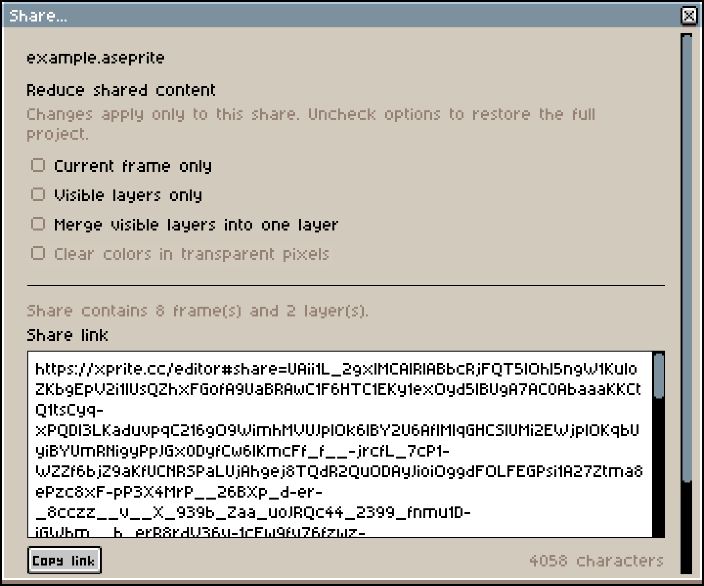
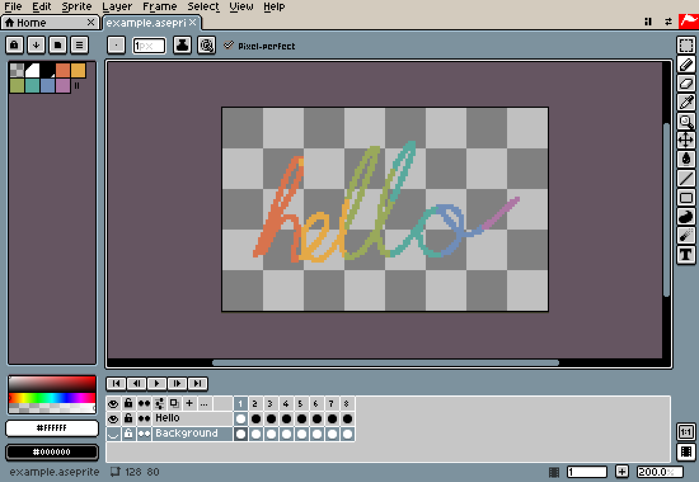
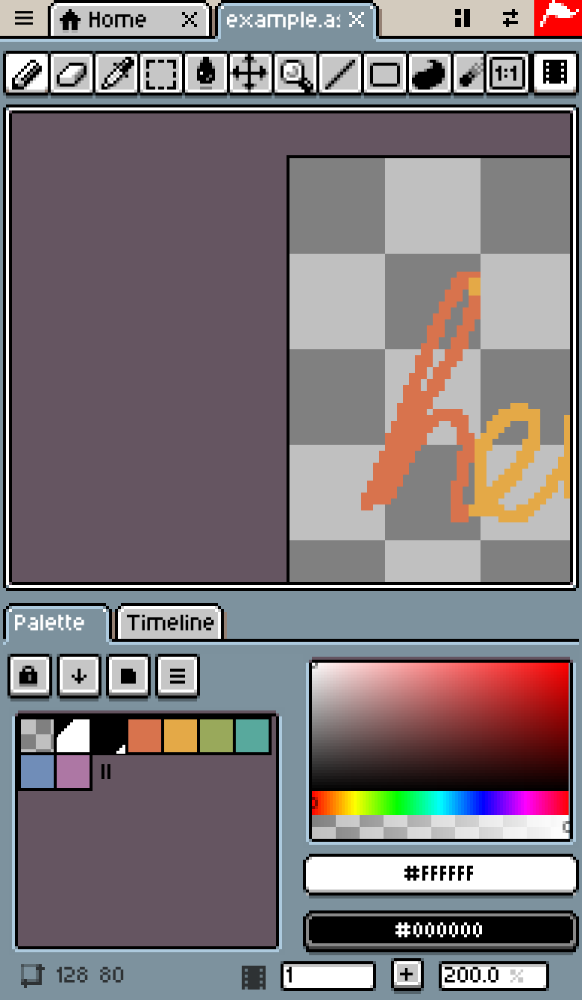

# Как устроен Xprite

Xprite переносит редактор Aseprite в браузер: ничего не нужно устанавливать, не нужен аккаунт, и нет сервера, на котором хранились бы ваши рисунки. В этой статье с инженерной стороны рассказано, как мы читаем и записываем `.aseprite` в браузере, как рисуем чёткие пиксели с помощью Canvas, где хранятся ваши работы, как редактор открывается без подключения и как настольный интерфейс, созданный для мыши, подстраивается под пальцы, перо и экран телефона.

## Общая картина

Вся работа редактора происходит в браузере. Тяжёлые задачи выполняются в Web Workers, для хранения используются встроенные в браузер IndexedDB и OPFS, а сеть нужна только для загрузки страницы, отправки анонимной аналитики и отзывов.

```article-diagram
{
  "kind": "map",
  "label": "Части Xprite в браузере",
  "root": "Xprite в браузере",
  "branches": [
    {
      "label": "Чтение и запись файлов",
      "featured": true,
      "items": [
        { "label": "Разбор .aseprite", "detail": "Декодирование в Worker, с основным потоком как запасным вариантом" },
        { "label": "Экспорт изображений", "detail": "Кодирование через OffscreenCanvas или canvas" }
      ]
    },
    {
      "label": "Отображение холста",
      "items": [
        { "label": "Сведение слоёв", "detail": "Только Canvas 2D, без WebGL" },
        { "label": "Увеличение пикселей", "detail": "Целые масштабы рисуются напрямую; дробные — выборкой по таблицам" }
      ]
    },
    {
      "label": "Сохранение работы",
      "items": [
        { "label": "Запись файлов на устройство", "detail": "File System Access API, а если его нет — скачивание" },
        { "label": "Хранение в браузере", "detail": "Каталог в IndexedDB + данные в OPFS" }
      ]
    },
    {
      "label": "Обработка ввода",
      "items": [
        { "label": "Перо или пальцы", "detail": "Перо в приоритете; пальцы переключаются на сдвиг холста" },
        { "label": "Распознавание жестов", "detail": "Щипок для масштаба; касание двумя и тремя пальцами — отмена и повтор" }
      ]
    }
  ]
}
```

## Чтение и запись .aseprite в браузере

### Формат файла

`.aseprite` — двоичный формат с порядком байтов little-endian: 128-байтовый заголовок, за которым идут кадры, каждый из нескольких чанков. Магическое число заголовка — `0xA5E0`, кадра — `0xF1FA`. Наш декодер обрабатывает такие чанки:

| Тип чанка | Содержимое                                                                        |
| --------- | --------------------------------------------------------------------------------- |
| `0x2004`  | Слой: обычный слой, группа, слой тайловой карты                                   |
| `0x2005`  | Cel: сырые пиксели, связанный cel, пиксели со сжатием zlib, сжатая тайловая карта |
| `0x2006`  | Дополнительные данные cel (точная позиция и размер)                               |
| `0x2007`  | Цветовой профиль                                                                  |
| `0x2008`  | Ссылки на внешние файлы                                                           |
| `0x2018`  | Метки (диапазоны анимации)                                                        |
| `0x2019`  | Палитра                                                                           |
| `0x2020`  | Пользовательские данные (текст, цвет, свойства)                                   |
| `0x2022`  | Срез                                                                              |
| `0x2023`  | Тайлсет                                                                           |

Также читаются старые чанки палитры `0x0004` и `0x000B`, а устаревшие чанки маски (`0x2016`) и пути (`0x2017`) распознаются.

### Сначала проверка, потом декодирование

Файл, открытый в браузере, может прийти откуда угодно, поэтому декодирование идёт в два прохода. Первый проход просматривает весь файл и проверяет, что длина, смещение и количество каждого чанка не выходят за пределы файла. Только после этого начинается настоящее декодирование. Повреждённые файлы и файлы сверх ограничений отсеиваются на этапе проверки, а не падают на полпути. Текущие ограничения:

| Параметр         | Ограничение          |
| ---------------- | -------------------- |
| Сторона холста   | 32 768 пикселей      |
| Одно изображение | 64 миллиона пикселей |
| Кадры            | 4096                 |
| Слои             | 256                  |

### Декодирование в Worker

Распаковка десятков кадров занимает время, и в основном потоке она заморозила бы интерфейс. Когда вы открываете файл, мы передаём его отдельному Worker для декодирования, а готовые пиксельные буферы возвращаются в основной поток как объекты `Transferable`, без копирования. Если браузер не поддерживает Workers или Worker дал сбой, декодирование выполняется в основном потоке.

Пиксельные данные сжаты zlib. Мы предпочитаем встроенный в браузер `DecompressionStream("deflate")` и ограничиваем его вывод размером, указанным в заголовке чанка, чтобы защититься от «бомб» распаковки. Если он не поддерживается, используется [fflate](https://github.com/101arrowz/fflate). Этот путь выделяет буфер ровно заявленного размера и проверяет контрольную сумму Adler-32.

### Распаковываются только нужные пиксели

При открытии файла cel в RGB проверяются, но не распаковываются полностью. Исходные сжатые байты остаются в памяти, а каждый кадр распаковывается, когда он нужен. Большие проекты не приходится распаковывать в память целиком.

### То, что не менялось, записывается как было

При сохранении в `.aseprite` кодировщик оставляет нетронутое содержимое без изменений:

- Неизменённые cel записываются из сжатых байтов, сохранённых с момента открытия, без повторного сжатия.
- Неизвестные чанки записываются как есть, поэтому файлы из более новых версий Aseprite не теряют данные при сохранении в Xprite.
- Повторно сжатые cel используют сжатую версию, только если она меньше сырых данных.
- Сжатие выполняет встроенный в браузер `CompressionStream`. Если он не поддерживается, файл сохраняется без сжатия. Он больше, но Aseprite его открывает.

## Отрисовка холста только через Canvas 2D

Xprite не использует WebGL. Холсты для пиксель-арта обычно маленькие; сложность в том, чтобы каждый пиксель оставался чётким. При любом масштабе и плотности экрана пиксель должен выглядеть квадратом с резкими краями, а не размытым пятном после сглаживания браузером.

### От слоёв к экрану

```article-diagram
{
  "kind": "flow",
  "label": "Одно обновление экрана",
  "steps": [
    { "label": "Сведение слоёв", "detail": "Собрать текущий кадр с учётом порядка слоёв, непрозрачности и режима наложения" },
    { "label": "Преобразование цветов", "detail": "Преобразовать по цветовому профилю проекта и закэшировать результат" },
    { "label": "Загрузка изменённой области", "detail": "putImageData только для прямоугольника, изменённого этим штрихом, в холст изображения" },
    { "label": "Отрисовка вида", "detail": "Размножить пиксели под масштаб и добавить шахматный фон, пиксельную сетку и рамки" },
    { "label": "Вывод на экран", "detail": "Целые масштабы рисуются напрямую; дробные — выборкой по таблицам" }
  ]
}
```

Пока вы рисуете, редактор запоминает прямоугольник, который изменил каждый штрих, и при отрисовке записывает в холст изображения только эту область, а не всё изображение каждый раз. Готовый вид (пиксели, шахматный фон, сетка) кэшируется на базовом холсте. Ключ кэша включает версию пикселей, положение вида, настройки отображения и так далее. Движение курсора не меняет ключ, поэтому базовый холст переиспользуется, а заново рисуется только предпросмотр кисти.

### Целые и дробные масштабы

Последний шаг выводит вид на экран. Если вид отображается на экран в точном целом масштабе, сглаживание отключается и работу выполняет браузерный `drawImage`:

```ts
if (Number.isInteger(scaleX) && Number.isInteger(scaleY) /* and no offset */) {
  presentation.imageSmoothingEnabled = false;
  presentation.drawImage(sourceCanvas, 0, 0, sourceWidth, sourceHeight,
                         0, 0, canvas.width, canvas.height);
  return;
}
presentation.putImageData(renderer.render(context.getImageData(...)), 0, 0);
```

При дробных масштабах — например, при плотности экрана 1,5 или масштабе браузера 110% — браузеры по-разному выполняют выборку в `drawImage`. Столбцы пикселей получаются неровными, или всё изображение смещается на полпикселя. В этом случае мы сами делаем выборку по ближайшему соседу: для целевого размера заранее вычисляем, какому исходному пикселю соответствует каждый столбец и строка, и храним это в двух таблицах `Int32Array`. Каждый пиксель копируется одним `Uint32`, а серии одинаковых строк копируются целиком через `copyWithin`.

Интерфейс следует той же идее: каждый элемент рисуется с 2 сэмплами на логический пиксель. Изменение размера окна браузера меняет только размер рабочей области; кнопки и меню остаются прежнего размера.

### Импорт и экспорт изображений

PNG, JPEG, WebP и другие изображения кодирует и декодирует браузер:

- Для декодирования предпочтителен `createImageBitmap`, запасной вариант — элемент ``.
- Для кодирования предпочтителен `OffscreenCanvas.convertToBlob`, запасной вариант — `toBlob` у `<canvas>`.
- Если браузер не поддерживает формат, `toBlob` не выдаёт ошибку, а тихо возвращает PNG. Поэтому после кодирования мы проверяем фактический тип результата, а перед экспортом кодируем тестовое изображение 1×1, чтобы узнать, какие форматы браузер умеет экспортировать.

## Где хранятся ваши работы

Проект можно сохранить в двух местах; выбор делается в разделе **Место сохранения** окна **Сохранить как...**:


| Место             | Используемые функции браузера | Если недоступно                     |
| ----------------- | ----------------------------- | ----------------------------------- |
| Файловый менеджер | File System Access API        | Файл скачивается                    |
| Браузер           | IndexedDB + OPFS              | Данные проекта хранятся в IndexedDB |

Проекты в браузере существуют только в этом браузере на этом устройстве и не синхронизируются. Очистка данных сайта удаляет и их. См. [руководство пользователя](/help/#сохранение-и-восстановление).

### Файловый менеджер: запись прямо в исходный файл

В браузерах с поддержкой File System Access API (настольные Chrome, Edge и другие) **Открыть** и **Сохранить** вызывают системные диалоги файлов. Мы получаем дескриптор файла, а не его копию:

- Дескриптор хранится в IndexedDB, поэтому следующее **Сохранить** записывает в тот же файл, не спрашивая куда.
- Перед записью мы запрашиваем разрешение на чтение и запись, а затем пишем через `createWritable()`.
- Браузеры требуют, чтобы диалог файла открывался непосредственно по нажатию пользователя, поэтому мы вызываем `showSaveFilePicker()` сразу после нажатия, без других асинхронных действий между ними.
- Когда страница встроена в iframe другого сайта (например, игрового портала), браузер не разрешает диалоги файлов. Тогда Xprite скачивает файл, как и в браузерах без поддержки.

### Браузер: каталог в IndexedDB и данные в OPFS

Для проектов в браузере каталог (имя, размер, время изменения, текущая версия) всегда хранится в IndexedDB. Данные проекта по возможности хранятся в OPFS (origin private file system — закрытая область диска, которую браузер выделяет каждому сайту). OPFS используется, только если браузер поддерживает Workers, `navigator.storage.getDirectory()`, Web Locks и записываемые дескрипторы файлов. Тип хранилища выбирается при создании проекта и больше не меняется, так что изменение поддержки в браузере не может заставить старые проекты исчезнуть.

Чтение и запись OPFS выполняются в отдельном Worker, который пишет, обрезает и сбрасывает данные через синхронный дескриптор доступа (`createSyncAccessHandle`). Каждое сохранение проходит такие шаги:

```article-diagram
{
  "kind": "flow",
  "label": "Сохранение проекта в браузере",
  "steps": [
    { "label": "Кодирование проекта", "detail": "В Worker закодировать проект в .aseprite с метаданными вроде текущего кадра и слоя" },
    { "label": "Разбиение данных", "detail": "Свыше 256 КиБ — разбить по границам чанков .aseprite на сегменты до 1 МиБ" },
    { "label": "Запись новых сегментов", "detail": "Убрать дубликаты по размеру и SHA-256 и переиспользовать сегменты с одинаковым содержимым" },
    { "label": "Чтение и проверка", "detail": "Прочитать всё обратно, сравнить контрольные суммы и сразу прервать при любом усечении" },
    { "label": "Публикация версии", "detail": "В транзакции IndexedDB перевести каталог на новую версию, сохранив предыдущую" }
  ]
}
```

Несколько правил защищают данные от повреждения:

- Данные только дописываются. Каждый ключ можно записать один раз, а файлы, запись которых сорвалась на полпути, удаляются.
- Текущую версию переключает только финальная транзакция каталога, и только если другая вкладка не изменила её раньше (сравнение с обменом).
- Когда Xprite открыт в нескольких вкладках, Web Locks делают запись взаимоисключающей.
- Разбиение по границам чанков `.aseprite` оставляет неизменённые кадры и слои в тех же сегментах. Правка одного кадра записывает только изменившиеся сегменты.

### Автоматическое восстановление

Автоматическое восстановление использует тот же путь хранения, что и сохранение в браузер. Пока вы работаете, Xprite по умолчанию записывает данные для восстановления каждые 2 минуты и хранит их 7 дней. Интервал и число дней меняются в **Правка → Настройки → Файлы**. Если браузер неожиданно закрылся, выберите на главной **Восстановить файлы...**, чтобы вернуть работу.

## Ссылки для обмена: спрайт живёт после

**Файл → Поделиться...** ничего не загружает. Спрайт сжимается и записывается в часть ссылки после `#share=` (фрагмент URL). Браузеры не отправляют на сервер ничего после `#`, поэтому обмен никогда не затрагивает сервер.



```article-diagram
{
  "kind": "flow",
  "label": "Создание ссылки для обмена",
  "steps": [
    { "label": "Варианты упаковки", "detail": "Упаковать пиксели несколькими способами: поканальные плоскости, разница кадров, индексированный цвет, тайлы" },
    { "label": "Выбор самого маленького", "detail": "Попробовать каждый вариант без сжатия, с DEFLATE и с Zstd и оставить самый маленький" },
    { "label": "Кодирование в текст", "detail": "Ссылки используют Base64url; для QR-кодов пробуются Base32 и Base43 и выбирается самый короткий" },
    { "label": "Сборка ссылки", "detail": "Адрес редактора + #share= + метка кодировки + данные" }
  ]
}
```

- Упаковка, сжатие и декодирование выполняются в Worker. Zstd работает как WebAssembly: данные сначала сжимаются на уровне 19, а результаты меньше 1 МиБ сжимаются ещё раз на более высоком уровне. Если WebAssembly не загрузился, используется только DEFLATE, и ссылка всё равно открывается.
- Буквенно-цифровой режим QR-кода тратит всего 5,5 бита на символ, что компактнее байтового режима, поэтому QR-коды используют кодировку Base43 только из символов этого режима.
- Когда ссылка открывается, редактор читает данные после `#share=`, сразу убирает их из адресной строки через `history.replaceState` и передаёт в Worker для декодирования.
- Для ссылок длиннее 1800 символов показывается предупреждение: некоторые мессенджеры могут их обрезать. Ссылки длиннее 8192 символов не создаются.

Ссылка содержит полный редактируемый проект. Любой, у кого есть полная ссылка, может его открыть; ссылки не истекают, и их нельзя отозвать. Если вы отправляете ссылку или QR-код через мессенджер, это приложение тоже получает данные рисунка.

## Работа офлайн: одна полная версия за раз

После добавления Xprite на рабочий стол или экран «Домой» Service Worker кэширует редактор, чтобы он открывался без подключения. (Для кэша нужно хотя бы раз открыть редактор онлайн; шаги описаны в [руководстве пользователя](/help/#установка-на-рабочий-стол-и-работа-офлайн).) Стратегия кэширования построена вокруг согласованности версий:

- Каждая сборка создаёт манифест ресурсов своей версии с SRI-хешем для каждого файла. При установке `cache.addAll` кэширует весь манифест разом. Если какой-то файл не скачался или его хеш не совпал, версия не вступает в силу, так что старые и новые файлы никогда не смешиваются.
- Когда всё закэшировано, записывается метка готовности, и офлайн-запуск использует только версии с этой меткой.
- Новая версия начинает работать сразу после установки, но уже открытые страницы продолжают выполнять старый код. Старые ресурсы с хешированными именами сохраняются, чтобы такие страницы могли их загрузить.
- Кэшируется только результат сборки. Аналитика, адрес для отзывов и страницы сайта идут мимо кэша.
- Кэш старой версии удаляется только после закрытия всех окон редактора.

В браузерах с поддержкой мы также запрашиваем постоянное хранилище (`navigator.storage.persist()`), чтобы браузер с меньшей вероятностью удалил ваши работы при нехватке места.

## Сенсорные экраны и перо

У мыши один указатель, а на сенсорном экране одновременно могут быть перо и несколько пальцев. Слой ввода обрабатывает их по таким правилам:

| Ситуация                           | Что происходит                                                                                |
| ---------------------------------- | --------------------------------------------------------------------------------------------- |
| Перо и палец касаются одновременно | Перо в приоритете и прерывает действие пальца                                                 |
| После обнаружения пера             | Один палец по умолчанию сдвигает холст, чтобы ладонь не оставляла случайных следов            |
| Касается второй палец              | Текущий штрих отменяется и начинается жест двумя пальцами                                     |
| Щипок двумя пальцами               | Масштабирует холст                                                                            |
| Касание двумя или тремя пальцами   | Отмена или повтор                                                                             |
| После касания пальцем              | Xprite сначала решает, касание это или перетаскивание, и только потом начинает редактирование |

Порог перетаскивания зависит и от типа указателя: палец должен сдвинуться больше чем на 8 CSS-пикселей, чтобы это считалось перетаскиванием, а мыши или перу достаточно 1 пикселя.

### Более точные штрихи

Ради экономии ресурсов браузеры объединяют несколько событий `pointermove` за один кадр в одно. Когда вы рисуете пером, мы берём все объединённые сэмплы из `getCoalescedEvents()`, каждый со своим значением нажима. Браузеры также предлагают предсказанные сэмплы, которые мы не используем: предсказанная точка может не совпасть с реальным штрихом и ни в коем случае не должна попасть в историю отмены.

```ts
/** Real samples only: predicted input must never reach document history. */
const coalesced = event.getCoalescedEvents?.() ?? [];
const actual = coalesced.filter(
  (point) => point.pointerId === event.pointerId && point.pointerType === "pen",
);
```

### Apple Pencil на iPad

В Safari на iPad касания Apple Pencil по умолчанию вызывают системное поведение, например выделение текста и Scribble. Обработчики касаний в React пассивные и не могут отменить поведение по умолчанию, поэтому мы регистрируем непассивный нативный обработчик `touchstart` прямо на холсте и перетаскиваемых элементах и вызываем `preventDefault()`, только когда `touchType` равен `stylus`. Текстовые поля и другие редактируемые области это не затрагивает, так что в них по-прежнему можно писать через Scribble.

## Компоновка: от окна на компьютере до телефона в портретной ориентации

Интерфейс Xprite воссоздаёт Aseprite 1.3. Размеры окон и положение элементов взяты из замеров Aseprite 1.3.18, и тесты следят за их соответствием. Графика темы повторяет пиксельный стиль Aseprite, а китайский интерфейс использует шрифт Fusion Pixel.

На широком экране вы получаете привычную настольную компоновку: строка меню сверху, палитра слева, инструменты справа и таймлайн внизу.



Такая компоновка не помещается на телефоне в вертикальном положении. Когда **Компоновка рабочего пространства** установлена в **Авто** (по умолчанию), мы выбираем компоновку по доступному месту. Её также можно закрепить как **Широкую** или **Компактную**; см. [руководство пользователя](/help/#настройка-рабочего-пространства). Правила такие:

| Основание                            | Условие                                     | Результат                                                                                   |
| ------------------------------------ | ------------------------------------------- | ------------------------------------------------------------------------------------------- |
| Соотношение сторон доступной области | ≥ 1,2                                       | Широкая компоновка: панели по краям                                                         |
| Соотношение сторон доступной области | < 1,2                                       | Компактная компоновка: инструменты в ряд сверху, палитра и таймлайн во вкладках под холстом |
| Ширина доступной области             | < 768 CSS-пикселей                          | Интерфейс переходит на компактную плотность                                                 |
| Точки касания или точность указателя | Любые точки касания или `(pointer: coarse)` | Сенсорный режим взаимодействия                                                              |

В компактной компоновке строка меню сворачивается в кнопку ☰ в левом верхнем углу, а интерфейс не заходит в безопасные зоны вроде выреза и скруглённых углов:



Компоновка и режим взаимодействия определяются отдельно. iPad в горизонтальном положении использует широкую компоновку и сенсорное взаимодействие одновременно. Сужение окна настольного браузера включает компактную компоновку, но сохраняет взаимодействие мышью.

## Какие данные отправляет Xprite

Редактирование, сохранение и обмен не используют сеть. Отправляются только два вида данных:

| Данные                  | Когда отправляются                       | Включают                                                                                                   | Не включают                                                 |
| ----------------------- | ---------------------------------------- | ---------------------------------------------------------------------------------------------------------- | ----------------------------------------------------------- |
| Аналитика использования | При использовании официальной веб-версии | Посещения страниц, использование функций, категории ошибок, возможности браузера, примерное местоположение | Пиксели рисунков, имена документов, локальные пути к файлам |
| Отзывы                  | При отправке **Проблем и предложений**   | Тип отзыва, сообщение, необязательный адрес почты, сведения о текущем визите                               | —                                                           |

Аналитика использования отправляется в PostHog Cloud (США):

- Идентификатор посетителя хранится в `localStorage` браузера.
- Исходный IP-адрес удаляется после добавления примерного местоположения.
- Автоматический сбор кликов отключён. Часть сеансов записывается как повторы: текстовые поля маскируются, содержимое холстов, включая рисунки, не записывается, а адреса страниц сокращаются до пути.
- Если включить в браузере Do Not Track и снова открыть Xprite, данные об использовании больше не отправляются.

Подробности — в [уведомлении о конфиденциальности](/privacy/).

## Открытый исходный код

Исходный код всего, что здесь описано, доступен на [GitHub](https://github.com/rhinoc/xprite). Код редактора распространяется по лицензии GPL-2.0-only.
