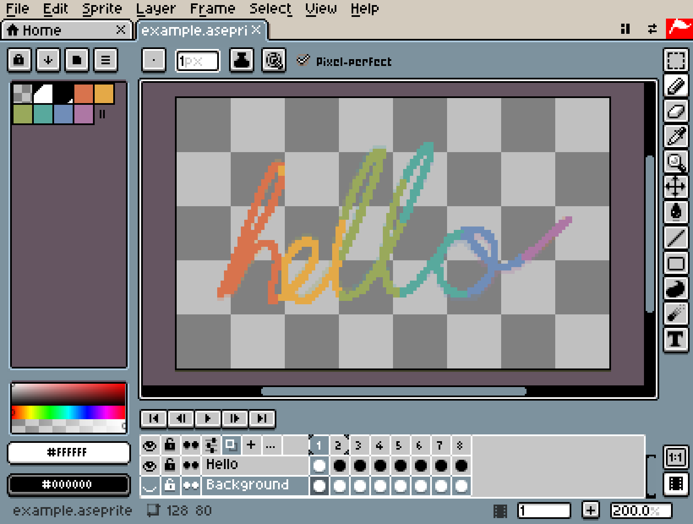
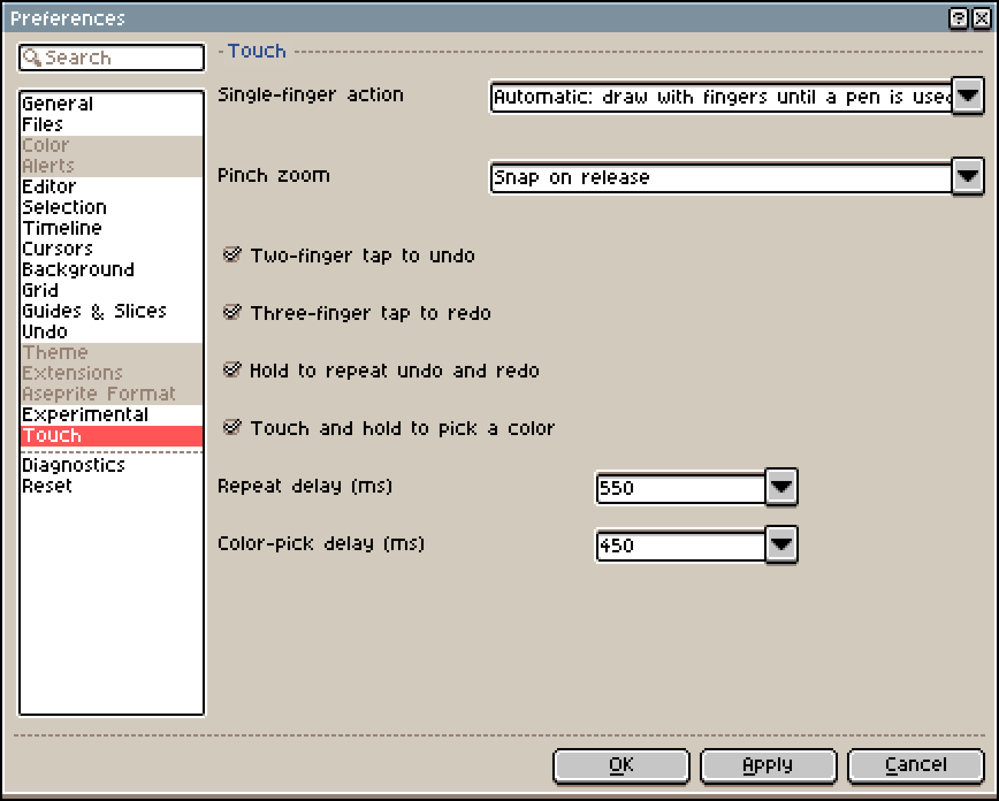
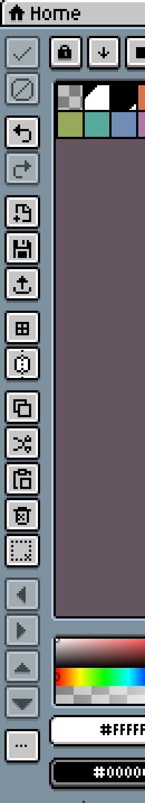
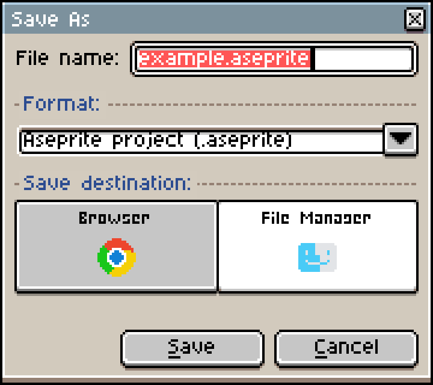

# Aseprite en iPad: una opción gratis y 3 apps comparadas

No existe una versión de Aseprite para iPad. Las descargas [oficiales](https://www.aseprite.org/faq/#what-do-i-get-when-i-buy-aseprite) son solo para Windows, macOS y Ubuntu. Para seguir trabajando en un proyecto `.aseprite` en el iPad, necesitas otro editor que lea ese formato. Hay dos caminos principales:

- Seguir dibujando gratis: abre Xprite en Safari, importa el proyecto y guárdalo de nuevo en `.aseprite` cuando termines. No hay nada que instalar ni compras dentro de la app.
- Comprar una app para iPad: Pixquare, Resprite y Pixaki Pro importan proyectos `.aseprite` y admiten el doble toque del Apple Pencil. Los dos primeros también admiten el gesto de apretar del Apple Pencil Pro.

El precio no es la única diferencia. La tabla compara los cuatro editores función por función.

|                                   | Xprite                              | Pixquare                                             | Resprite                                       | Pixaki Pro                               |
| --------------------------------- | ----------------------------------- | ---------------------------------------------------- | ---------------------------------------------- | ---------------------------------------- |
| Precio                            | 🆓 Gratis, sin compras en la app    | 💰 Pago único, 24,99 USD para todos los dispositivos | 💰 Suscripción o pago único                    | 💰 Intro es gratis, Pro se paga aparte   |
| Plataformas                       | ✅ Navegador                        | ✅ iPhone, iPad, Mac                                 | ✅ iPhone, iPad, Android, Windows, Mac         | ⚠️ Solo iPad                             |
| Importar `.aseprite`              | ✅ Lo abre directamente             | ✅ Puede conservar el formato original               | ⚠️ Se convierte a `.resprite`, con pérdidas    | ✅ Sí                                    |
| Exportar `.aseprite`              | ✅ Escribe el formato original      | ✅ Sí                                                | ⚠️ Se pierden algunos efectos                  | ✅ Conserva capas y cels                 |
| Papel cebolla                     | ✅ Sí, y etiquetas                  | ✅ Sí                                                | ✅ Sí, y clips                                 | ✅ Sí, y cuadros sostenidos              |
| Mapas de tiles                    | ✅ Editables                        | ✅ Se pueden animar                                  | ⚠️ Sí, pero los importados no se pueden editar | —                                        |
| Doble toque del Apple Pencil      | ❌ No                               | ✅ Sigue los ajustes del sistema                     | ✅ Personalizable                              | ✅ Sí                                    |
| Apretar                           | ❌ No                               | ✅ Abre un menú o la paleta                          | ✅ Personalizable                              | —                                        |
| Sin conexión                      | ⚠️ Abrir una vez con conexión antes | ✅ Proyectos guardados en el dispositivo             | ✅ Proyectos guardados en el dispositivo       | ✅ Proyectos guardados en el dispositivo |
| Sincronización entre dispositivos | ⚠️ Guardar archivos a mano          | ✅ Sincronización con iCloud                         | ⚠️ Exportar `.resprite` a mano                 | ✅ Sincronización con iCloud             |

## En qué destacan Pixquare, Resprite y Pixaki

Lo más fuerte de estas tres apps es la entrada con Apple Pencil y con los dedos:

|          | Doble toque                                  | Apretar                                  | Un dedo                                        |
| -------- | -------------------------------------------- | ---------------------------------------- | ---------------------------------------------- |
| Pixquare | Sigue los ajustes del sistema                | Abre el menú de herramientas o la paleta | Desplazar, o cambiar de cuadro y de capa       |
| Resprite | 6 acciones para elegir                       | Se le pueden asignar acciones similares  | —                                              |
| Pixaki   | Compatible con Apple Pencil (2.ª generación) | —                                        | Herramienta actual, borrador, desplazar o nada |

Estos son los detalles de controles y precios:

- Pixquare: puedes configurar el lienzo para que solo dibuje el lápiz. Entonces un dedo desplaza el lienzo o pasa de un cuadro o una capa a otra. La versión solo para iPhone cuesta 7,99 USD; durante los 3 días siguientes a la primera descarga, la versión para todos los dispositivos cuesta 19,99 USD.
- Resprite: el doble toque puede ser borrador, cuentagotas, herramienta anterior, bote de pintura, lápiz o deshacer. Al superar un umbral de presión se activa una segunda acción, y el tamaño del pincel sigue la presión. La prueba exporta todos los formatos sin marca de agua, pero con un límite diario; Premium quita el límite y añade ajustes de color, contornos avanzados, simetría y fuentes personalizadas. Las compras no se transfieren entre tiendas de apps, pero iPhone y iPad comparten una misma compra con la misma cuenta de Apple. La versión para Mac requiere un Mac con Apple silicon.
- Pixaki: la versión gratuita Intro se limita a 3 capas más 1 capa de referencia, 8 cuadros y un lienzo de 160 × 160. Pro desbloquea la importación y exportación de `.aseprite`, lienzos de hasta 8192 px por lado y hasta 2 MP en total. Los proyectos guardados en iCloud se abren en varios dispositivos, y se comparten con otras personas como archivos `.pixaki`.

Las tres también exportan PSD y video, algo que Xprite no hace. Pixaki además es bueno para ajustar con precisión el ritmo de la animación: arrastra la línea de tiempo a izquierda y derecha y el lienzo la sigue. Asigna a un cuadro 2× de duración y obtienes un cuadro sostenido. Las duraciones siguen la velocidad de fotogramas del proyecto, así que a 10 fps, 1× es 0,1 segundos y 3× es 0,3 segundos. Las capas son de tres tipos: animación, estática y referencia.

## Cuándo usar Xprite

Si llevas el mismo archivo `.aseprite` de la computadora al iPad y viceversa y no quieres comprar otro editor, Xprite cumple. Funciona en el navegador, es gratis y no tiene compras dentro de la app. Al abrir un proyecto indexado de 8 bits o en escala de grises de 16 bits, el modo de color se mantiene, así que puedes seguir dibujando enseguida. Exporta `.aseprite`, PNG, GIF, APNG y hojas de sprites; JPEG y WebP dependen del navegador.



En Xprite, el Apple Pencil y los dedos se reparten el trabajo: en cuanto detecta un lápiz, el lápiz dibuja y el dedo desplaza el lienzo. Después de recargar la página, usa el lápiz una vez más para que vuelva a cambiar. Es la opción **Automático: dibujar con los dedos hasta usar un lápiz óptico** de **Acción con un dedo**, en **Editar → Preferencias → Táctil**, y ahí puedes elegir una opción fija.



Sin teclado, esto ayuda:

- Gestos: toca con dos dedos para deshacer y con tres para rehacer; mantén los dedos apoyados para repetir. También se admiten desplazar, hacer zoom y mantener pulsado para tomar un color. Puedes activarlos y desactivarlos como se explica en [Dedos y lápiz](/es/help/#dedos-y-lápiz).
- Barra de accesos rápidos: actívala en **Ver → Mostrar → Barra de accesos rápidos**. Con una selección, los botones de flecha la mueven de píxel en píxel, y **Mantener proporción**, **Desde el centro** y **Duplicar al arrastrar** sustituyen a las teclas modificadoras. Consulta [Barra de accesos rápidos](/es/help/#barra-de-accesos-rápidos).
- Pantalla de inicio: en Safari, toca el botón Compartir y luego **Agregar a pantalla de inicio**. Después de abrirlo una vez con conexión, puedes dibujar sin conexión. Si no se abre sin conexión, ábrelo otra vez con conexión. Consulta [Añadir al escritorio y usar sin conexión](/es/help/#añadir-al-escritorio-y-usar-sin-conexión).
- Compartir: **Archivo → Compartir...** empaqueta el proyecto en un enlace o un código QR en tu dispositivo, sin subirlo a ningún sitio. La otra persona abre una copia, así que no pueden editar juntos. Si el proyecto es demasiado grande, exporta un archivo.



Eso sí, Xprite no tiene ajustes para el doble toque ni para apretar. Si dependes de esos gestos, te conviene más una de las tres apps anteriores.

## Cómo llevar archivos `.aseprite` al iPad

Para editar el mismo proyecto en una computadora y en un iPad:

```article-diagram
{
  "kind": "flow",
  "label": "Un archivo .aseprite entre una computadora y un iPad",
  "steps": [
    {
      "label": "Importa el proyecto",
      "detail": "Abre Xprite en Safari e importa el archivo .aseprite. Las capas y los cuadros llegan juntos."
    },
    {
      "label": "Edita capas y cuadros",
      "detail": "Sigue dibujando en el iPad o ajusta la animación."
    },
    {
      "label": "Guarda como .aseprite",
      "detail": "Archivo → Guardar como → Gestor de archivos guarda el archivo en este dispositivo."
    },
    {
      "label": "Cópialo de vuelta a la computadora",
      "detail": "Ábrelo en tu editor de siempre y sigue trabajando."
    }
  ]
}
```

Xprite abre `.ase` y `.aseprite` y conserva lo siguiente al leerlos y escribirlos:

- Capas de imagen, grupos de capas, capas de mapa de tiles y tilesets
- Duración de los cuadros en milisegundos
- Dirección de las etiquetas (hacia delante, inversa, ping-pong, ping-pong inverso) y número de repeticiones
- Slices

Xprite no puede abrir archivos con una profundidad de color distinta de 8, 16 o 32 bits, ni archivos que superen los límites de 32.768 píxeles por lado del lienzo, 4096 cuadros o 256 capas. Cuando eso ocurre, el proyecto abierto no se reemplaza.

**Archivo → Guardar como** ofrece dos lugares para guardar (los pasos están en [Guardar y recuperar](/es/help/#guardar-y-recuperar)):

- Gestor de archivos: guarda el archivo en este dispositivo. Si el navegador no tiene diálogo de guardado, el archivo se descarga.
- Navegador: el proyecto solo se vuelve a abrir en este navegador y en este dispositivo. Borrar los datos del sitio también elimina sus copias de recuperación.



Las otras tres apps convierten algo al importar un proyecto `.aseprite`:

- [Pixquare](https://docs.pixquare.art/pixquare-file/create-import): puedes convertir a `.px` al importar o conservar el formato original. Si conservas el formato original, se desactivan el guardado automático, la copia de seguridad automática y el timelapse. Pixquare también puede [exportar](https://docs.pixquare.art/pixquare-file/exporting) `.aseprite`.
- [Resprite](https://resprite.fengeon.com/docs/files/aseprite): los proyectos se convierten a `.resprite` y se pierde parte de la información:
  - La duración de los cuadros se redondea a pasos de 100 ms; todo lo que sea más corto cuenta como 100 ms
  - No se conservan las etiquetas superpuestas ni el número de repeticiones, y el ping-pong inverso pasa a ser ping-pong
  - El color indexado pasa a ser color normal, y se pierden los nombres de los colores de la paleta
  - Los mapas de tiles del archivo `.aseprite` no se pueden editar como mapas
  - Al exportar de nuevo a `.aseprite`, los mapas de tiles de Resprite se convierten en píxeles normales, los estilos dinámicos como contornos y sombras no se dibujan en la imagen, y no se conservan la opacidad ni los modos de fusión de los grupos
- [Pixaki](https://pixaki.com/user-guide/export/): importar y exportar requiere Pro, y las exportaciones conservan capas y cels. La duración de un cuadro es la velocidad de fotogramas del proyecto × los cuadros sostenidos, lo que difiere de las duraciones en milisegundos que guarda `.aseprite`.

PNG, GIF y las hojas de sprites no tienen capas. Sirven para entregar el trabajo terminado, pero guarda una copia `.aseprite` aparte de todo lo que vayas a seguir editando. Si solo necesitas una imagen animada, consulta [Aseprite a GIF](/tools/viewer/#export-gif). Para solo abrir un proyecto en el navegador, consulta [Aseprite online](/es/compare/aseprite-online/).

## Preguntas frecuentes

### ¿Hay una versión de Aseprite para iPad?

No. Aseprite solo está disponible para Windows, macOS y Ubuntu.

### ¿Puedo usar Xprite sin un archivo `.aseprite`?

Sí. Puedes crear un lienzo nuevo y dibujar o animar de inmediato, e importar un archivo `.ase` o `.aseprite` cuando tengas uno.

### ¿Tocar con dos dedos es lo mismo que el doble toque del Apple Pencil?

No. Tocar con dos dedos es tocar el lienzo con los dedos, y Xprite lo usa para deshacer de forma predeterminada. El doble toque es tocar el lateral del Apple Pencil. Xprite no tiene ajustes para eso; Pixquare, Resprite y Pixaki sí.

---

Para ver qué tal se siente, abre [Xprite](/?utm_source=compare&utm_medium=referral&utm_campaign=aseprite-on-ipad) en Safari, importa un proyecto y prueba a deshacer, cambiar de cuadro y guardar.
