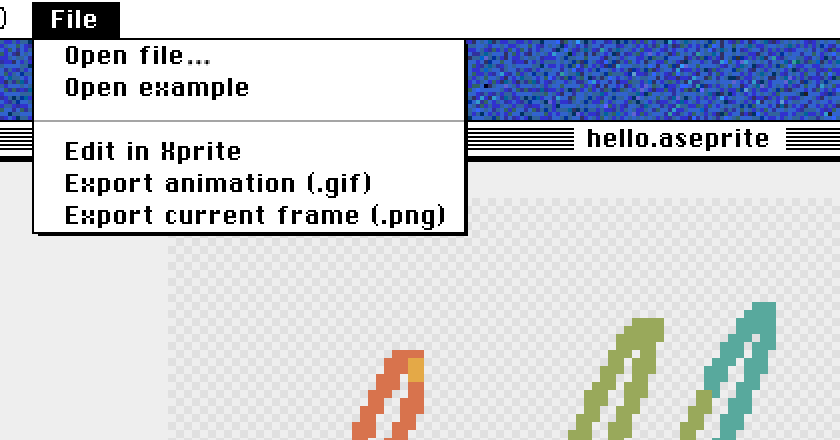

# 에이스프라이트 온라인 편집: 브라우저 도구 4종 비교

에이스프라이트(Aseprite)는 데스크톱 소프트웨어입니다. [공식](https://www.aseprite.org/faq/#what-do-i-get-when-i-buy-aseprite) 다운로드는 Windows, macOS, Ubuntu용뿐이므로, 브라우저에서 `.aseprite` 프로젝트를 열려면 이 형식을 읽을 수 있는 다른 도구를 써야 합니다. Xprite, Novaboard, Manabit, Pixelorama는 모두 `.aseprite`를 가져올 수 있지만, 가져온 뒤 프로젝트가 얼마나 그대로 남는지, `.aseprite`로 다시 저장할 수 있는지, 로그인이 필요한지가 다릅니다.

- 파일 내용을 보거나 PNG·GIF 하나만 뽑으려면: [Xprite 뷰어](/tools/viewer/?utm_source=compare&utm_medium=referral&utm_campaign=aseprite-online)를 쓰세요.
- 파일을 편집해서 Aseprite 사용자에게 다시 넘기려면: Xprite나 Pixelorama를 쓰세요. 둘 다 `.aseprite`로 저장할 수 있습니다.
- GIF, 영상, 게임 에셋용 새 애니메이션을 브라우저에서 그리려면: Novaboard와 Manabit도 살펴볼 만합니다.

|                      | Xprite                             | Novaboard                    | Manabit                             | Pixelorama                         |
| -------------------- | ---------------------------------- | ---------------------------- | ----------------------------------- | ---------------------------------- |
| 가격                 | 🆓 무료                            | 🆓 무료                      | 🆓 제한 있는 무료 플랜              | 🆓 무료                            |
| 계정                 | ✅ 필요 없음                       | ✅ 필요 없음                 | ⚠️ 저장하려면 로그인                | —                                  |
| `.aseprite` 가져오기 | ✅ 원본 형식 그대로 열기           | ✅ 지원                      | ⚠️ 레이어 애니메이션으로 변환       | ⚠️ 슬라이스와 마스크 제외          |
| `.aseprite`로 저장   | ✅ 지원                            | —                            | —                                   | ✅ v1.2.2부터                      |
| 기타 내보내기        | ✅ PNG, GIF, APNG, 스프라이트 시트 | ✅ GIF, MP4, 스프라이트 시트 | ✅ PNG, JPG, GIF, 애니메이션 스트립 | ✅ PNG, GIF, APNG, 스프라이트 시트 |
| 애니메이션           | ✅ 프레임, 태그, 어니언 스킨       | ✅ 프레임, 태그, 어니언 스킨 | ✅ 레이어 애니메이션, 동기화 재생   | ✅ 프레임, 태그, 오디오 레이어     |
| 타일맵               | ✅ 편집 가능                       | ⚠️ 이음매 없는 타일 모드     | ✅ 맵 에디터                        | ✅ 타일맵 레이어                   |
| 오프라인과 데스크톱  | ⚠️ 처음 한 번은 온라인에서 열기    | ✅ 오프라인 동작             | 💰 라이선스로 Windows 앱            | ✅ 무료 데스크톱 앱                |

## 먼저 뷰어로 파일 확인하기

누군가 `.aseprite` 파일을 보내 주면, 내용을 보거나 프레임 하나만 뽑아 전달하면 되는 경우가 많습니다. 이럴 때는 Xprite 뷰어로 충분합니다.

1. [뷰어](/tools/viewer/)를 열고 **파일 → 파일 열기**를 선택하거나 `.ase`·`.aseprite` 파일을 끌어 놓으세요.
2. 애니메이션을 재생하세요. **애니메이션 범위**에서 태그나 **모든 프레임**을 고르세요.
3. GIF는 **파일 → 애니메이션 내보내기(.gif)**, PNG 한 장은 **현재 프레임 내보내기(.png)** 메뉴를 선택하세요.

뷰어에서 레이어를 숨겨도 미리 보기와 내보내기에만 적용되고 파일은 바뀌지 않습니다. 수정하려면 **Xprite에서 편집**을 선택하세요. 에디터에서 원본 파일이 열립니다.

## 브라우저에서 편집하고 `.aseprite`로 다시 저장하기

Xprite 에디터는 `.ase`와 `.aseprite`를 원본 형식 그대로 읽습니다. 레이어, 레이어 그룹, 타일맵, 태그, 밀리초 단위 프레임 지속 시간이 모두 유지됩니다. 작업을 마치면 **파일 → 다른 이름으로 저장 → 파일 관리자**로 `.aseprite` 파일을 기기에 저장한 뒤, Aseprite에서 열어 계속 작업할 수 있습니다.

다음 파일은 Xprite에서 열 수 없으며, 이때 열려 있던 프로젝트는 그대로 남습니다.

- 8, 16, 32비트가 아닌 색 깊이
- 한 변이 32,768픽셀을 넘는 캔버스
- 4,096개가 넘는 프레임 또는 256개가 넘는 레이어

**다른 이름으로 저장**의 다른 저장 위치는 **브라우저**입니다. 여기에 저장한 프로젝트는 같은 기기의 같은 브라우저에서만 열리며, 사이트 데이터를 지우면 삭제됩니다. 다른 사람에게 넘길 파일이라면 **파일 관리자**가 더 안전합니다.

Pixelorama도 [v1.2.2](https://github.com/Orama-Interactive/Pixelorama/releases/tag/v1.2.2)(2026년 9월 9일)부터 `.aseprite`를 내보낼 수 있습니다. 다만 [가져오기](https://pixelorama.org/user_manual/Import)에서 슬라이스, 셀 사용자 데이터, 색 프로필, 외부 파일, 마스크가 빠지고, 그레이스케일 프로젝트는 RGBA로 변환됩니다. 가져올 때 읽지 않은 내용은 내보내도 돌아오지 않습니다.

## Novaboard, Manabit, Pixelorama가 더 잘하는 것

이 세 도구는 브라우저에서 처음부터 그리는 쪽에 가깝고, 각각 Xprite에 없는 기능이 있습니다.

- [Novaboard](https://marcel0ll.itch.io/novaboard): 설치도 가입도 필요 없습니다. `.aseprite` 외에 PSD, ORA, GAL, PIXIL, 애니메이션 GIF도 엽니다. MP4와 JSON 아틀라스를 내보낼 수 있고, 레이어에 색조, 커브, 대비 같은 비파괴 조정을 적용할 수 있습니다.
- [Manabit](https://manabit.app/docs/features/import-export/): 한 프로젝트에 캐릭터, 타일셋, 맵, UI를 담을 수 있고, Map Builder로 타일셋에서 바로 레벨을 칠할 수 있습니다. 애니메이션을 한 줄에 하나씩 배치한 PNG 스트립으로, 1배에서 8배까지 확대해 내보낼 수 있습니다. 로그인 후 무료 플랜에서는 로컬 프로젝트 1개와 클라우드 프로젝트 1개(클라우드 저장 공간 25MB)를 쓸 수 있습니다. 일회성 라이선스를 사면 로컬 프로젝트 제한이 없어지고 Windows 데스크톱 앱이 추가됩니다.
- [Pixelorama](https://pixelorama.org/user_manual/installation): 무료 오픈 소스로, Windows, macOS, Linux용 데스크톱 앱과 웹 버전이 있으며 Android 버전은 실험 단계입니다. 타임라인에서 오디오 레이어를 지원하고, 타일맵은 사각형, 아이소메트릭, 육각형을 쓸 수 있습니다.

## 데스크톱 Aseprite가 여전히 필요한 경우

Aseprite [확장 기능, 스크립트, 명령줄 내보내기](https://www.aseprite.org/docs/)에 의존하는 작업 방식이라면 데스크톱 앱을 계속 쓰세요. 브라우저 도구는 파일 확인, 간단한 수정, 완성 이미지 전달에 더 알맞습니다.

## 자주 묻는 질문

### Aseprite 공식 웹 버전이 있나요?

없습니다. Aseprite는 Windows, macOS, Ubuntu용으로만 제공됩니다.

### `.ase`와 `.aseprite`는 다른가요?

아니요, 같은 형식입니다. Xprite는 두 확장자를 모두 엽니다.

### 브라우저에서 연 파일이 업로드되나요?

Xprite 뷰어는 파일을 기기에서 처리하며 업로드하지 않습니다. 에디터에서 **브라우저**에 저장한 프로젝트도 현재 기기에만 남습니다.

---

시작하려면 [뷰어에서 파일을 열거나](/tools/viewer/?utm_source=compare&utm_medium=referral&utm_campaign=aseprite-online) [Xprite에서 편집](/?utm_source=compare&utm_medium=referral&utm_campaign=aseprite-online)해 보세요. 애니메이션 이미지만 필요하다면 [Aseprite를 GIF로](/tools/viewer/#export-gif)를, 아이패드 편집은 [아이패드 Aseprite](/ko/compare/aseprite-on-ipad/)를 참고하세요.
