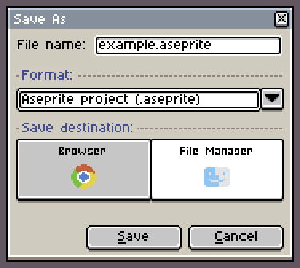
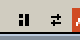
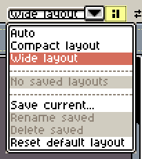
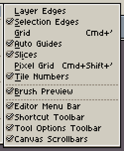
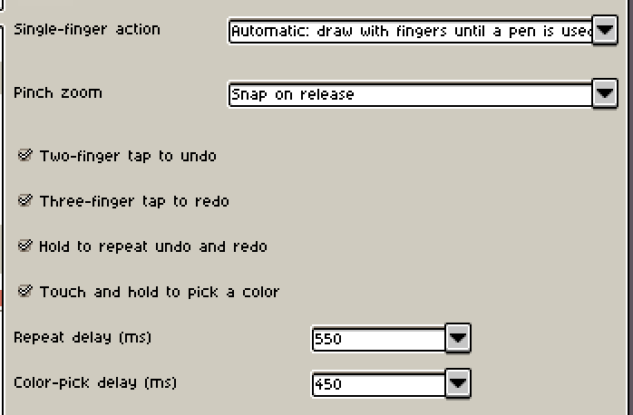
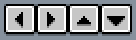
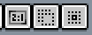
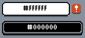
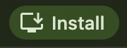
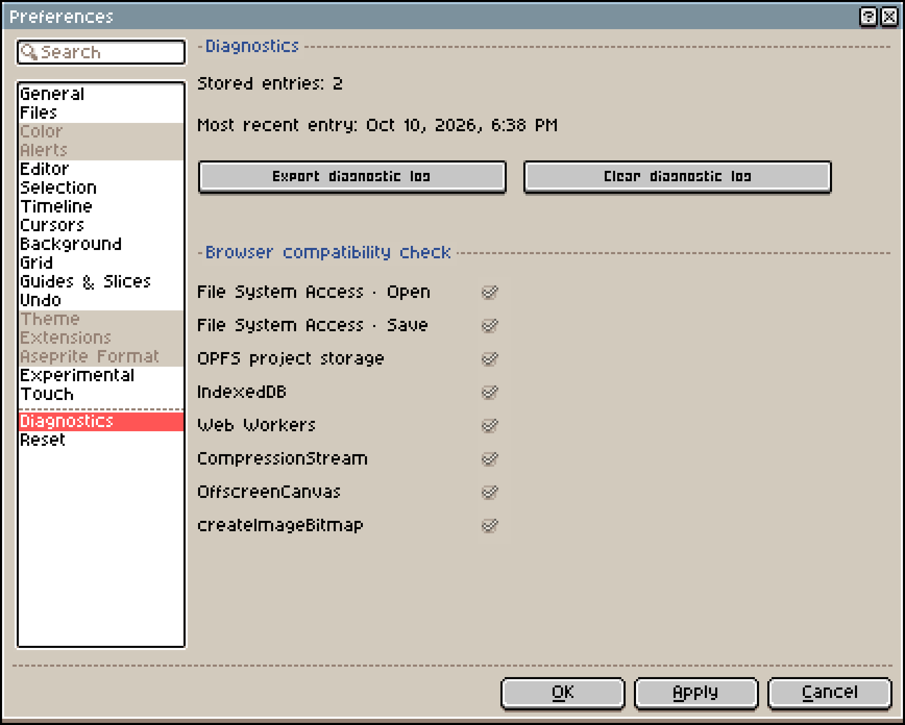

# 사용 가이드

- [저장과 복구](#저장과-복구)
- [파일 열기와 내보내기](#파일-열기와-내보내기)
- [작업 공간 정리](#작업-공간-정리)
- [컨트롤 표시와 숨기기](#컨트롤-표시와-숨기기)
- [마우스, 트랙패드, 단축키](#마우스-트랙패드-단축키)
- [손가락과 펜](#손가락과-펜)
- [단축 도구 모음](#단축-도구-모음)
- [외부 이미지 붙여넣기](#외부-이미지-붙여넣기)
- [화면에서 색 추출하기](#화면에서-색-추출하기)
- [바탕 화면에 추가하고 오프라인으로 사용하기](#바탕-화면에-추가하고-오프라인으로-사용하기)
- [동물의 숲 마이 디자인 내보내기](#동물의-숲-마이-디자인-내보내기)
- [스프라이트 공유하기](#스프라이트-공유하기)
- [그리기 과정 리플레이](#그리기-과정-리플레이)
- [브라우저와 기기](#브라우저와-기기)
- [자주 묻는 질문](#자주-묻는-질문)
- [문제 신고](#문제-신고)

## 저장과 복구

**파일 → 다른 이름으로 저장**에는 두 가지 저장 위치가 있습니다.

- **브라우저**: 프로젝트가 이 기기의 이 브라우저에만 저장되며 동기화되지 않습니다. 나중에 홈의 **최근 파일**에서 다시 열 수 있습니다.
- **파일 관리자**: 프로젝트를 `.aseprite` 또는 `.png` 파일로 기기에 저장합니다. 나중에 **파일 → 열기**로 다시 열 수 있습니다. 브라우저에 저장 대화 상자가 없으면 파일이 다운로드됩니다.

사이트 데이터를 지우면 브라우저 프로젝트와 복구 백업이 모두 삭제됩니다. 기기나 브라우저를 바꾸거나 데이터를 지우기 전에 **파일 관리자**에 사본을 저장하세요.

"변경 사항이 이 브라우저에 저장되지 않았습니다."라는 메시지가 보이면 프로젝트를 연 상태에서 **다시 저장**을 선택하거나, **다른 이름으로 저장 → 파일 관리자**로 파일 사본을 저장하세요.

기본적으로 Xprite는 2분마다 복구 데이터를 저장하고, 편집한 스프라이트 데이터를 7일 동안 보관합니다. 두 설정 모두 **편집 → 환경설정 → 파일**에서 바꿀 수 있습니다. 브라우저가 갑자기 닫혔다면 홈에서 **파일 복구**를 선택하고 **이전 세션**에서 작업을 복원하세요.

브라우저 사본을 삭제하려면 먼저 프로젝트를 닫은 다음, **최근 파일**에서 해당 메뉴를 열고 **브라우저 사본 삭제**를 선택하세요. 브라우저 프로젝트와 캐시된 이미지, 복구 백업이 삭제됩니다. 기기에 저장한 파일에는 영향이 없습니다.

## 파일 열기와 내보내기

**파일 → 열기**로 열 수 있는 파일:

- Aseprite 프로젝트(`.ase`, `.aseprite`). 레이어, 프레임, 태그가 함께 열립니다.
- PNG, JPEG 등 브라우저가 디코딩할 수 있는 모든 형식의 이미지.
- 애니메이션 GIF와 WebP. 각 프레임이 프레임으로 가져와집니다.

스프라이트 시트를 열려면 **파일 → 스프라이트 시트 가져오기**를 사용하고, Xprite가 각 프레임을 찾을 수 있도록 프레임 범위를 설정하세요.

Aseprite 프로젝트는 가로·세로 최대 32,768픽셀, 프레임 최대 4,096개, 레이어 최대 256개까지 지원합니다. Xprite는 아직 Aseprite의 모든 기능을 구현하지 않았고 Aseprite 스크립트나 확장 기능을 실행할 수 없으므로, 일부 프로젝트는 Aseprite와 똑같이 열리지 않을 수 있습니다.

사진이나 픽셀 아트가 아닐 수 있는 이미지를 열면 **이미지 픽셀화** 대화 상자가 나타납니다.

- 너비와 높이(1~16,384), 색 수(2~256)를 정한 뒤 **픽셀화하여 가져오기**를 선택합니다.
- 이미지를 그대로 가져오려면 **원본 유지**를 선택합니다.

내보내기 옵션은 모두 **파일 → 내보내기**에 있습니다.

- **다른 이름으로 내보내기...**: 단일 이미지는 PNG, JPEG, WebP로, 애니메이션은 GIF, APNG, WebP로 내보냅니다.
- **스프라이트 시트 내보내기**: PNG로 내보내며, 필요하면 **JSON 데이터**도 함께 내보낼 수 있습니다.
- **타일셋 내보내기**: PNG로 내보내며, 현재 레이어가 타일맵 레이어일 때 사용할 수 있습니다.

일부 브라우저는 JPEG나 WebP를 내보낼 수 없으며 "이 브라우저에서는 JPEG를 사용할 수 없습니다" 또는 "이 브라우저에서는 WebP를 사용할 수 없습니다"라고 표시됩니다. 이때는 PNG로 내보내세요.

"파일을 열 수 없습니다."라는 메시지가 보이면 다음을 차례로 확인하세요.

- 파일이 Aseprite 프로젝트이거나 브라우저가 지원하는 이미지 형식인지.
- 파일이 온전하며 다운로드나 복사 중에 손상되지 않았는지.
- Aseprite 프로젝트가 위의 크기, 프레임, 레이어 제한 안에 있는지.

## 작업 공간 정리

문서 탭 옆의 **작업 공간 레이아웃**으로 패널을 배치합니다.

- 패널 핸들이나 탭을 끌어 놓기 안내선에 맞추면 패널을 도킹하거나, 나란히 놓거나, 탭으로 합칠 수 있습니다.
- 패널 핸들이나 탭의 메뉴를 열면 떠 있는 창으로 만들거나 **버튼으로 접기**를 할 수 있습니다.

**자동**은 창의 여유 공간에 맞춰 레이아웃을 고릅니다.

배치를 저장하려면 **현재 레이아웃 저장**을 사용하세요. 저장된 레이아웃을 선택한 상태에서 바꾸면 그 레이아웃이 업데이트되므로, 이전 배치를 남기려면 먼저 새 사본으로 저장하세요.

## 컨트롤 표시와 숨기기

메뉴 막대와 도구 모음의 표시 여부는 **보기 → 표시**에서 바꿉니다.

메뉴 막대를 숨긴 뒤에는 문서 탭 왼쪽의 **메뉴**로 **보기 → 표시**를 다시 열 수 있습니다. 도구 옵션 도구 모음을 숨긴 뒤에는 선택한 도구를 클릭하면 설정이 열립니다.

화면에 다 들어가지 않는 도구는 도구 레일을 따라 밀어서 볼 수 있습니다. 가로 레일은 마우스 휠과 트랙패드로도 스크롤할 수 있습니다.

## 마우스, 트랙패드, 단축키

기본적으로 마우스 휠은 캔버스를 확대·축소하고, 트랙패드에서 두 손가락으로 밀면 화면을 이동하며, 핀치하면 확대·축소합니다.

기기 감지가 정확하지 않다면 **편집 → 환경설정 → 편집기 → 휠 장치**에서 **마우스 휠** 또는 **트랙패드**를 선택하세요. 캔버스 휠 확대와 두 손가락 밀기 확대 설정도 같은 항목에 있습니다.

브라우저나 운영체제가 이미 사용하는 단축키라면 메뉴나 단축 도구 모음을 대신 사용하거나, **편집 → 키보드 단축키**에서 키 지정을 바꾸세요.

## 손가락과 펜

기본 제스처:

- **두 손가락으로 끌기**: 캔버스를 이동합니다.
- **두 손가락으로 핀치**: 확대·축소합니다. 손을 떼면 확대 단계에 맞춰집니다.
- **두 손가락으로 탭**: 실행 취소합니다.
- **세 손가락으로 탭**: 다시 실행합니다.
- **두 손가락 또는 세 손가락을 대고 있기**: 실행 취소나 다시 실행을 반복합니다.
- **한 손가락으로 길게 누르기**: 색을 추출합니다.

펜을 사용하기 전까지는 손가락으로 그릴 수 있습니다. 펜을 사용한 뒤에는 손가락으로 화면을 이동하고 펜으로 그립니다.

손가락으로 항상 그리거나 항상 이동하려면 **편집 → 환경설정 → 터치 → 한 손가락 동작**에서 모드를 고르세요. 이 항목에서 핀치 확대, 실행 취소·다시 실행 제스처, 색 추출, 길게 누르기 시간도 설정할 수 있습니다.

## 단축 도구 모음

**보기 → 표시 → 단축 도구 모음**에서 켤 수 있습니다. 방향 버튼은 선택 영역을 한 픽셀씩 옮기고, **비율 고정**, **중심에서 그리기**, **드래그하여 복제**는 해당 키보드 보조 키를 대신합니다.

사각형 선택, 타원 선택, 올가미가 **바꾸기** 또는 **교차** 모드일 때 선택 영역 밖을 탭하면 선택이 해제됩니다. 손가락이 이동으로 설정되어 있어도 동작하며, 끌면 여전히 캔버스가 이동합니다.

## 외부 이미지 붙여넣기

다른 앱의 이미지를 붙여넣으려면 브라우저 클립보드 권한이 필요할 수 있습니다.

붙여넣기에 실패하면 이미지를 파일로 연 다음, Xprite 안에서 원하는 프로젝트로 복사하세요.

## 화면에서 색 추출하기

**Alt**(Mac에서는 **Option**)를 누른 채 전경색 또는 배경색 버튼을 클릭하면 편집기 밖의 색을 추출할 수 있습니다.

화면 색 추출에는 데스크톱용 Chrome 또는 Edge가 필요하며, Xprite를 HTTPS나 localhost로 열어야 합니다. 브라우저가 지원하지 않으면 이미지를 Xprite에서 열고 거기서 색을 추출하세요.

## 바탕 화면에 추가하고 오프라인으로 사용하기

- **Chrome 또는 Edge**: **도움말 → 바탕 화면에 추가**를 선택합니다. 이 항목이 없으면 브라우저 메뉴의 **앱 설치**를 사용하세요.
- **Mac의 Safari**: **파일 → Dock에 추가**를 선택합니다.
- **iPhone·iPad의 Safari**: **공유**를 탭한 다음 **홈 화면에 추가**를 선택합니다. **공유**는 페이지 메뉴 안에 있을 수 있습니다.

오프라인으로 사용하기 전에 온라인 상태에서 편집기를 한 번 열어 두세요. 오프라인에서 열리지 않으면 인터넷에 연결한 뒤 다시 여세요.

## 동물의 숲 마이 디자인 내보내기

**파일 → 내보내기**에서 **내보내기 형식 → 게임과 공예 → 모여봐요 동물의 숲**을 선택합니다. 원본 이미지의 칸을 클릭하면 해당 QR 코드가 선택됩니다. 선택한 칸의 오른쪽 가장자리, 아래쪽 가장자리, 오른쪽 아래 모서리에 마우스를 올리고 끌면 크기를 바꿀 수 있습니다. 격자 원점에서 끌면 격자가 이동하고, 간격 핸들은 위쪽이나 왼쪽에 나타납니다. 핸들은 마우스를 올리면 나타나며, 터치스크린에서는 가장자리를 탭해 핸들을 띄운 다음 끌면 됩니다. 값은 왼쪽에서 직접 입력할 수도 있습니다.

## 스프라이트 공유하기

**파일 → 공유**를 선택한 다음, **링크 복사**로 링크를 보내거나 **QR 코드 저장**을 선택합니다. 상대방이 링크를 열거나 코드를 스캔하면 스프라이트를 볼 수 있습니다. 스프라이트는 링크의 `#share=` 뒷부분에 압축되어 들어갑니다. 링크는 기기에서 만들어지며 서버에는 아무것도 업로드되지 않습니다.

- 전체 링크를 가진 사람은 누구나 스프라이트를 열 수 있습니다. 링크는 만료되지 않으며 취소할 수 없습니다.
- 1,800자가 넘는 링크에는 일부 채팅 앱에서 잘릴 수 있다는 경고가 표시됩니다. 8,192자가 넘는 링크는 만들 수 없습니다.
- 스프라이트가 너무 크면 현재 프레임이나 보이는 레이어만 공유하거나, 파일로 내보내서 보내세요.
- 링크가 QR 코드에 담기에는 너무 길면 링크 복사만 할 수 있습니다.

## 그리기 과정 리플레이

**스프라이트 → 그리기 과정 → 녹화 시작**으로 녹화를 시작합니다. 다 끝나면 **녹화 중지**로 리플레이를 열거나, **녹화 계속**으로 이어서 녹화합니다.

녹화를 보려면 **그리기 과정 리플레이**를 엽니다.

- **내보내기**로 `.xprite-replay` 파일로 저장할 수 있으며, 나중에 **리플레이 열기**로 재생할 수 있습니다.
- 내보내기 버튼의 드롭다운에 있는 **캔버스 GIF 내보내기**로 애니메이션 GIF를 만들 수 있습니다.

리플레이는 브라우저 프로젝트와 함께 저장되지만 PNG나 Aseprite 파일에는 포함되지 않습니다. 브라우저나 기기를 바꾸기 전에 `.xprite-replay` 파일을 따로 내보내세요.

## 브라우저와 기기

파일 읽기·쓰기, 클립보드, 화면 색 추출은 브라우저가 지원하고 허용하는 기능에 따라 달라집니다. Xprite에는 최소 브라우저 버전이 없습니다. 대신 **편집 → 환경설정 → 진단**을 열고 **브라우저 호환성 확인**을 살펴보세요. 체크 표시는 해당 기능을 지원한다는 뜻입니다.

확인에 실패하면 이렇게 동작합니다.

- ⚠️ File System Access · 열기: 브라우저 기본 파일 선택기를 대신 사용합니다.
- ⚠️ File System Access · 저장: **파일 관리자**가 파일을 대신 다운로드합니다.
- ⚠️ OPFS 프로젝트 저장소: 브라우저 프로젝트를 IndexedDB에 대신 저장합니다.
- ❌ IndexedDB: 최근 파일을 저장할 수 없습니다.
- ❌ Web Workers: 링크 공유와 무손실 WebP 내보내기를 사용할 수 없습니다.
- ⚠️ CompressionStream: `.aseprite` 파일이 압축되지 않은 채 저장되어 용량이 커집니다.

자주 보이는 메시지:

- "이 브라우저에서는 공유를 사용할 수 없습니다.": 브라우저가 Web Workers를 지원하지 않습니다. 파일로 내보내서 보내세요.
- "IndexedDB를 사용할 수 없어 이 브라우저에 최근 파일을 저장할 수 없습니다.": 브라우저가 사이트 저장소를 끄거나 제한했습니다. **파일 관리자**에 저장하세요.
- "다른 브라우저 탭이 최근 파일 저장소를 사용 중입니다.": Xprite가 여러 탭에서 열려 있습니다. 다른 탭을 닫고 다시 시도하세요.
- "Aseprite 캔버스가 브라우저 리소스 한도를 초과합니다": Aseprite 프로젝트의 캔버스가 너무 커서 브라우저가 처리할 수 없습니다.

캔버스가 크고 프레임과 레이어가 많을수록 메모리를 많이 사용합니다. 휴대폰과 태블릿은 컴퓨터보다 메모리가 적어서, 큰 프로젝트는 열리지 않거나 느리게 동작할 가능성이 높습니다.

## 자주 묻는 질문

### Xprite는 무료인가요?

네. Xprite는 무료 오픈 소스입니다. 편집기 코드는 GPL-2.0-only, 재사용 가능한 UI 패키지는 MIT 라이선스입니다.

### 계정이 필요한가요?

아니요. 페이지를 열고 바로 그리면 됩니다. 계정이 없으며 작품이 계정에 동기화되지도 않습니다.

### 작품이 서버에 업로드되나요?

아니요. 편집, 저장, 공유가 모두 브라우저 안에서 이루어지며, Xprite에는 작품을 저장하는 서버가 없습니다. 네트워크로 전송되는 것은 페이지 분석 데이터와 직접 보낸 피드백뿐이고, 둘 다 작품을 포함하지 않습니다. [개인정보 안내](/privacy/)와 [Xprite 작동 방식](/about/how-it-works/)을 참고하세요.

### Xprite와 Aseprite는 어떤 관계인가요?

Xprite는 에이스프라이트(Aseprite)의 인터페이스와 작업 방식을 따르지만 독립된 프로젝트입니다. Aseprite나 Igara Studio S.A.와 제휴하거나 보증을 받지 않았습니다.

### 인터페이스 언어는 어떻게 바꾸나요?

기본적으로 브라우저 언어를 따릅니다. 바꾸려면 **편집 → 환경설정 → 일반 → 언어**로 이동하세요.

### 작품이 사라졌어요. 어떻게 하나요?

먼저 홈의 **최근 파일**을 확인하세요. 없다면 **파일 복구**를 선택하고 **이전 세션**을 확인하세요. [저장과 복구](#저장과-복구)를 참고하세요.

## 문제 신고

**도움말 → 문제 및 제안**이나 홈 오른쪽의 **피드백**을 선택하세요. [GitHub Issues](https://github.com/rhinoc/xprite/issues)에 이슈를 올릴 수도 있습니다. 브라우저, 기기, 문제가 생기기까지의 단계를 함께 적어 주세요.

진단 로그가 필요하면 **편집 → 환경설정 → 진단**에서 내보내세요. 편집기 오류 대화 상자에도 내보내기 버튼이 있습니다.
